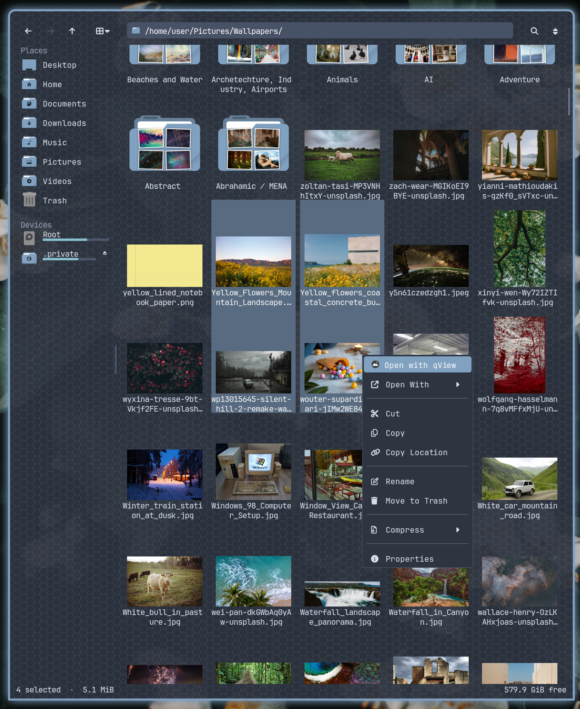

# file-browser-tui

<p align="center">
  
</p>

A Dolphin-like file manager for [kitty](https://sw.kovidgoyal.net/kitty/), built with
[ratatui](https://ratatui.rs). It has Dolphin's look and habits: a places sidebar, an
icon grid with real thumbnails, a clickable path bar, right-click menus and Dolphin's
shortcuts. It uses kitty's graphics to draw your icon theme, thumbnails and rounded
menus right in the terminal, and follows the freedesktop standards for the thumbnail
cache, trash, file types and default apps. Everything else is set in its own config
file.

It's as much a mouse app as a keyboard one. Click, double-click, Shift- and
Ctrl-click to select, drag a box around items, drag files onto folders, places or the
other side of a split, right-click anything for its menu, middle-click a folder to open
it in a tab, scroll with the wheel, and drag the sidebar's edge or the scrollbar. Every
action also has a keyboard shortcut.

## Features

- **Three views**: Icons (zoomable), Compact and Details (sortable columns, expandable
  folder tree). View settings are remembered per folder.
- **Show in Groups**: items grouped by name, date ("Today", "Yesterday", months, ...),
  size or type, in Details and Icons view, per folder.
- **Thumbnails** for images, videos (with film-strip edges), audio cover art, EPUB,
  comic books, OpenDocument and PDF, plus folder icons showing the pictures inside.
  They're saved in the shared freedesktop cache (`~/.cache/thumbnails`). What's on
  screen loads first, then the screens around it, then the first items of the folders
  you can see, so scrolling and opening folders feel instant.
- **Tabs and split view**: `Ctrl+T` opens a tab, middle-click opens a folder in a
  background tab, `F3` splits the view in two. Drag between the sides or use
  Copy/Move to Other Side. With one tab and no split, neither takes any space.
- **Places sidebar**: drag to reorder, right-click to add or remove. Drives show how
  full they are, and removable drives and network mounts get an eject button.
  Phones paired with KDE Connect show up too.
- **Location bar**: each folder in the path is clickable (click `Pictures` in
  `/home/me/Pictures/Wallpapers/` to go there), or type a path with completion
  (`Ctrl+L`, `F6`, `Alt+D`).
- **Search** by file name or inside files, in the current folder or below.
- **File operations**: copy, move, trash and delete, with a progress bar, time left and
  cancel. Name clashes ask like Dolphin does: Overwrite (or Write Into for folders),
  Skip, Rename, Apply to All.
- **Undo** (`Ctrl+Z`) for copies, moves, renames, trashing and new folders or files.
  Undoing a copy moves the copies to the trash rather than deleting them.
- **Archives**: Extract Here, which puts a single top-level folder beside the archive
  and gives loose files a folder of their own, or Extract Into a folder named after
  the archive. Zip, tar.*, 7z, rar, iso and more. Compress to tar.gz or zip.
- **Permissions** editor in Properties: read, write and execute for owner, group and
  others, optionally applied to a folder's contents (only the bits you changed, so
  files don't all become executable).
- **Clipboard** shared with other file managers: cut, copy and paste files between this
  and Dolphin, Nautilus and others, and paste copied text or pictures as new files.
- **Drag and drop**: rubber-band selection, dragging onto folders and places, and
  dropping files in from other programs.
- **Right-click menus**: Open With (your desktop's apps), Open Terminal Here, Compress,
  Extract, Send to Device (KDE Connect), Properties, and your own actions. KDE service
  menus you already have are imported on first run.
- **Configurable**: keyboard shortcuts, every interface color, icon theme, folder icons,
  spacing, which files get thumbnails, sidebar places and right-click actions.

## Requirements

- [kitty](https://sw.kovidgoyal.net/kitty/) 0.40 or newer (0.47 or newer to drop files in
  from other programs). The app is made for kitty: icons, thumbnails, menus and
  centered labels are drawn with kitty's graphics and text sizing protocols. Other terminals
  can start it, but without any of the images.
- A [Nerd Font](https://www.nerdfonts.com/) for menu and toolbar symbols.
- An icon theme (Breeze, Papirus, Adwaita, ...) and `rsvg-convert` (librsvg) to draw
  its icons.

Optional tools, used when installed. `file-browser-tui --check` lists what it found.

| Tool | For |
| --- | --- |
| `wl-clipboard` (Wayland) or `xclip` (X11) | the clipboard |
| `fd`, `ripgrep` | searching by name, searching inside files |
| `ffmpeg` (or `ffmpegthumbnailer`) | video thumbnails, audio cover art |
| `poppler` (`pdftoppm`) | PDF thumbnails (add `"pdf"` to `thumbnails`, see below) |
| `xdg-utils` | opening files with their default app |
| `libarchive` (`bsdtar`) | Extract (`7z`, `unrar` or `unzip` are used if it can't) |
| `zip` | Compress to zip |
| `udisks2` | unmounting and safely removing drives |
| `kdeconnect` | Send to Device, browsing phones |
| `glib2` (`gio`) | file type icons for unusual files |

## Install

### Arch Linux (AUR)

```sh
yay -S file-browser-tui
```

### From source

Needs Rust 1.92 or newer.

```sh
cargo build --release
install -Dm755 target/release/file-browser-tui ~/.local/bin/file-browser-tui
install -Dm644 file-browser-tui.desktop ~/.local/share/applications/file-browser-tui.desktop
```

## Running it

```sh
file-browser-tui --kitty [PATH]  # a new kitty window set up for the app
file-browser-tui [PATH]          # inside the kitty window you're in
```

`PATH` is a folder to open, or a file to open its folder with it selected.

Use `--kitty` in launchers, desktop entries and window manager bindings; the included
`file-browser-tui.desktop` does. It opens a kitty window without padding, so the
images line up with the edges, and passes Shift+click, Ctrl+Shift+click and
`Ctrl+Tab` to the app instead of kitty's own selection and tabs.

## Keyboard shortcuts

Dolphin's defaults, and every one can be changed (see [Keys](#keys)). `F1` in the app
lists them all, including any you've changed.

| Key | Action |
| --- | --- |
| Arrows | move |
| `Home` / `End` | first / last item |
| `PageUp` / `PageDown` | up / down a page |
| `Enter` | open |
| `Esc` | clear the selection, close search |
| `Backspace`, `Alt+←` | back |
| `Alt+→` | forward |
| `Alt+↑` | up a folder |
| `Ctrl+L`, `F6`, `Alt+D` | edit the location |
| `Ctrl+F` | search |
| `Ctrl+A` | select all |
| `Shift` + arrows, `Home`, `End`, `PageUp`, `PageDown` | extend the selection |
| `Shift+click` / `Ctrl+click` | select a range / add or remove one |
| `Ctrl+C` / `Ctrl+X` / `Ctrl+V` | copy / cut / paste |
| `Ctrl+Alt+C` | copy the location |
| `Ctrl+Z` | undo |
| `F2` | rename |
| `F10` | new folder |
| `Delete` / `Shift+Delete` | move to trash / delete permanently |
| `Alt+Enter` | properties |
| `Shift+F4` | open a terminal here |
| `Ctrl+H`, `Alt+.` | show or hide hidden files |
| `F5` | reload |
| `Ctrl+1` / `Ctrl+2` / `Ctrl+3` | Icons / Compact / Details view |
| `Ctrl+Plus` / `Ctrl+Minus` | larger / smaller icons |
| `Alt+[` / `Alt+]` | narrower / wider sidebar |
| `Ctrl+T` / `Ctrl+W` | new tab / close tab |
| `Ctrl+Tab` / `Ctrl+Shift+Tab` | next / previous tab (also `Ctrl+PageDown` / `Ctrl+PageUp`) |
| `F3` / `Ctrl+F3` | split view on or off / switch sides |
| `F1` | list the shortcuts |
| `Ctrl+Q` | quit |

## Configuration

`~/.config/file-browser-tui/config.toml` is created on first run with every option
listed and commented out. Its view settings are the defaults for folders you haven't
changed; changes you make in a folder are remembered for that folder.

### Keys

Every shortcut is an action you can rebind, from moving with the arrows to tabs and
split view. Listing an action replaces its default keys; an empty list unbinds it.
The generated config lists every action with its default keys. (Keys inside text
fields and dialogs, like typing a name, stay fixed.)

```toml
[keys]
new_folder = ["F10", "Alt+F"]
rename = ["F2", "Alt+R"]
up = ["Alt+Up", "Shift+Backspace"]
move_down = ["Down", "j"]
move_up = ["Up", "k"]
```

### Colors

17 color roles cover text, panels, borders, selection, hover, menus, scrollbars,
warnings and drag and drop. The generated config lists them all with their defaults
([Nord](https://www.nordtheme.com/)); set any of them and the rest keep theirs.
`text_strong` and `drop_target_text` default to your terminal's own text color.

```toml
[theme]
accent = "#88c0d0"
selection = "#3b4252"
panel = "#2e3440"
```

### Icons

```toml
icon_theme = "Papirus-Dark"   # empty: your desktop's (KDE, GTK or GNOME setting)
icon_size_idx = 7             # default zoom, 0 (smallest) to 19

[folder_icons]
"~/Projects" = "folder-development"
"~/Music" = "folder-music"
```

### Layout

```toml
sidebar_w = 18                # also set by dragging the sidebar's edge

[layout]
icon_spacing = 2              # Icons view: columns added to each icon's width
icon_label_lines = 2          # Icons view: lines of name under each icon (1-6)
compact_width = 22            # Compact view: width of each column
```

### Thumbnails

Choose which kinds of files show a thumbnail of their content: `images`, `svg`,
`videos`, `audio` (album art), `ebooks` (EPUB), `comics` (CBZ), `documents`
(OpenDocument) and `pdf`. The default is all of them except `pdf`.

```toml
thumbnails = ["images", "svg", "videos", "audio", "pdf"]
folder_previews = true        # show a folder's pictures on its icon
```

To keep a folder's thumbnails off disk (made when shown, never saved):

```toml
thumbnail_cache_exclude = ["~/Private"]
```

### KDE Connect

Paired phones appear under Devices and in Send to Device. To turn that off:

```toml
kdeconnect = false
```

### Right-click actions

Each `*.toml` file in `~/.config/file-browser-tui/actions/` adds actions to the
right-click menu; the `README.md` there explains the format. For example:

```toml
submenu = "Convert"
mime = ["video/*"]

[[action]]
label = "Convert to webm"
icon = "video"
command = "ffmpeg -i %f -y %f.webm"
```

## License

[GNU General Public License v3.0](LICENSE)
